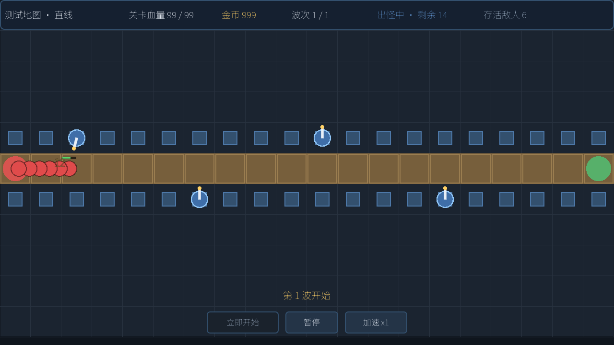
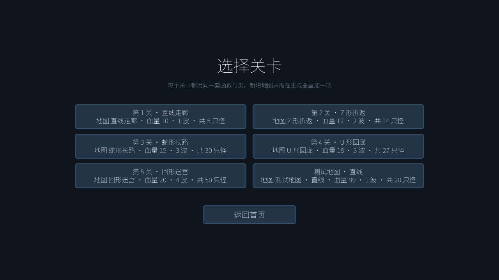
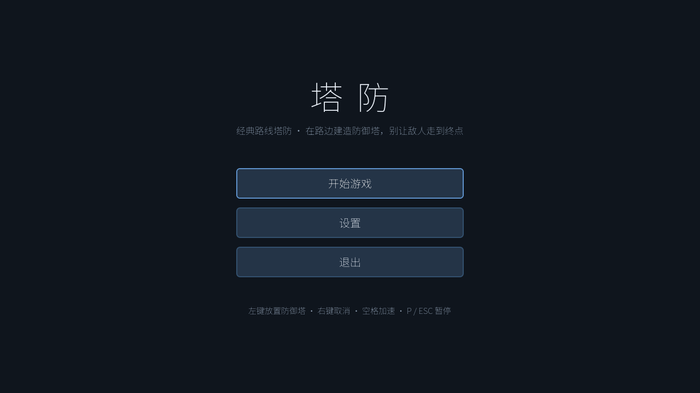
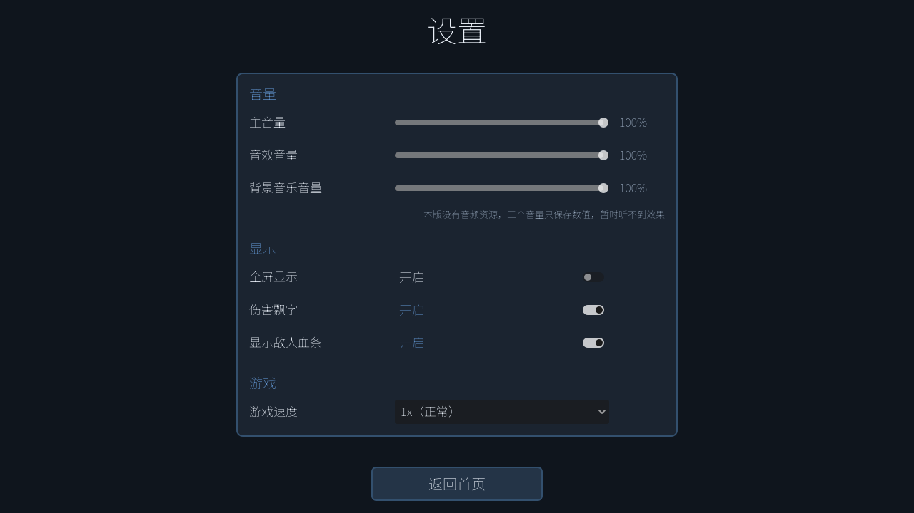
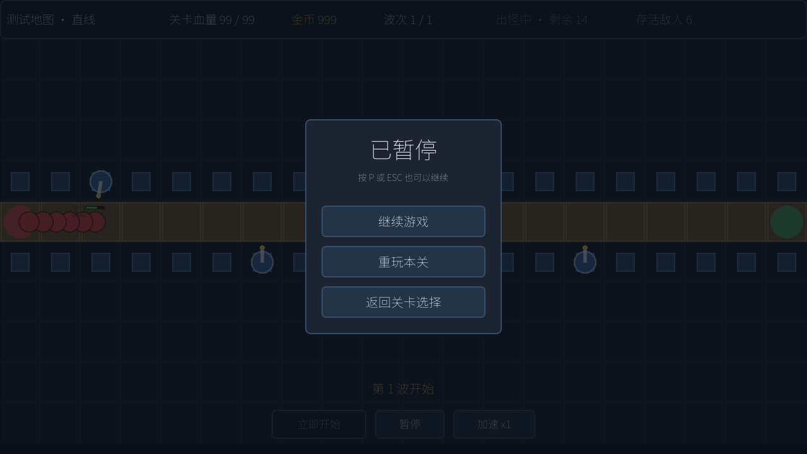
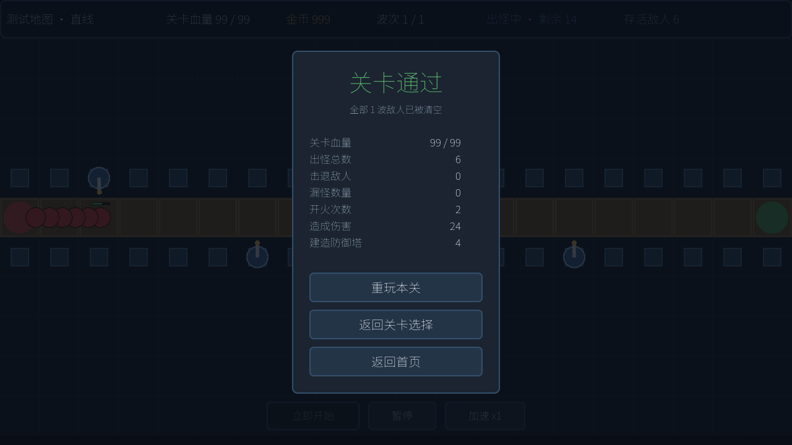

# 塔防 · Tower Defense（Godot 4.7.2）

一个**数据驱动**的经典塔防：固定地图、路点出怪、点击放置防御塔、波次推进、漏怪计数判负。

新关卡 / 新地图 / 新塔 / 新敌人都是往生成器的规格表里**加一条**，然后重跑一条命令。



---

# 游戏介绍

## 一句话

在固定网格地图上沿着敌人的行进路径布置箭塔，把一波波敌人拦在进怪口之前；
每漏掉一只怪扣 1 点关卡血量，血量归零即判负。

## 玩法循环

1. **选关** —— 主菜单 → 关卡选择，6 个关卡（5 个正式关 + 1 个测试图）自动列出。
2. **布防** —— 鼠标悬停在高亮的塔位格上，左键放置箭塔；塔会自动锁定射程内最靠前的敌人开火。
3. **推进** —— 波次按倒计时依次涌出，敌人从出怪口 `S` 沿路径走向进怪口 `G`。
4. **结算** —— 全部波次清空且血量 > 0 判胜；血量归零判负，战场立即冻结。

## 操作

| 操作 | 按键 |
|---|---|
| 放置防御塔 | **鼠标左键**（点击塔位格） |
| 取消当前操作 / 清除悬停高亮 | **鼠标右键** |
| 切换 1x / 2x 速度 | **空格** |
| 暂停 / 恢复 | **P** 或 **ESC** |

## 核心机制

- **关卡血量 = 允许漏怪数。** 初始 N 点，每漏 1 只怪扣 1 点（不分兵种），归零判负。
- **塔位与路径永不重叠。** 塔位是「与路径正交相邻的格子」，两者中心距离恒为 64 px。
- **敌人全部近战、永远够不到塔。** 敌人攻击射程 ≤ 48 px < 64 px，这是几何事实而非 AI 判断。
- **伤害有抗性公式。** 重甲敌人有 0.5 物理抗性，箭塔 12 点物理伤害实扣 6，伤害飘字也显示 6。
- **本版金币不设门槛。** 塔可以自由放置，但 `cost` 字段与金币统计都保留，随时可恢复经济系统。



## 内容量

| 类别 | 数量 | 明细 |
|---|---|---|
| 地图 | 6 张 | 直线走廊 / Z 形折返 / 蛇形长路 / U 形回廊 / 回形迷宫 / 测试直线 |
| 关卡 | 6 关 | level_01 ~ level_05 + level_test |
| 防御塔 | 1 种 | 箭塔（物理，射程 160，1.2 发/秒，伤害 12，造价 50） |
| 敌人 | 3 种 | 小兵 / 疾行 / 重甲（全部近战，不会攻击塔） |
| 波次 | 最多 4 波 | 出怪总数 5 ~ 50 |

## 游戏截图

| 主菜单 | 关卡选择 | 设置 |
|---|---|---|
|  |  |  |

| 战斗 | 暂停面板 | 结算面板 |
|---|---|---|
|  |  |  |

> 截图由 `tests/capture_shot.tscn` 自动生成到 `output/`（该目录已在 `.gitignore` 排除），
> `docs/screenshots/` 里是随仓库分发的版本。

---

# 如何配置游玩

## 1. 环境要求

| 项目 | 要求 |
|---|---|
| 引擎 | **Godot 4.7.2 stable**（`config/features` 锁定 `4.7`） |
| 渲染后端 | **GL Compatibility**（`gl_compatibility`，兼容性优先，老显卡/核显可跑） |
| 分辨率 | 1280 × 720，`canvas_items` 拉伸、`keep` 宽高比 |
| 字体 | 已内置 `assets/fonts/NotoSansSC-VF.ttf`（OFL 授权，含中文字形），**无需额外安装** |
| 操作系统 | 任意 Godot 支持的平台（本项目在 Windows 上开发验证） |

下载引擎：<https://godotengine.org/download/archive/4.7.2-stable/>

## 2. 获取代码

```bash
git clone https://github.com/1411541667/Tafang.git
cd Tafang
```

## 3. 运行

### 方式 A：用编辑器打开

```powershell
# 把路径换成你自己的 Godot 可执行文件
$GODOT = "D:\Godot\Godot_v4.7.2-stable_win64.exe\Godot_v4.7.2-stable_win64_console.exe"
$PROJ  = "D:\lz\lz\project\tafang"

Start-Process $GODOT -ArgumentList @("--editor", "--path", $PROJ)
```

首次打开 Godot 会导入资源、生成 `.godot/` 缓存目录（该目录已被 `.gitignore` 排除），稍等片刻即可。

### 方式 B：直接跑游戏（从首页开始）

```powershell
Start-Process $GODOT -ArgumentList @("--path", $PROJ)
```

> **注意**：如果 `godot` 不在 `PATH` 里，必须写可执行文件的**全路径**。

## 4. 操作

放置 **鼠标左键** · 取消 **鼠标右键** · 变速 **空格** · 暂停 **P / ESC**。

## 5. 游戏内设置

设置页可调整，写入 `user://settings.cfg` 持久化：

| 设置项 | 说明 |
|---|---|
| 主音量 / 音效 / 背景音乐 | 三条音频总线（Master / SFX / BGM），程序化创建并真实写入 `AudioServer` |
| 全屏 | 切换窗口 / 全屏模式 |
| 显示伤害飘字 | 是否显示命中伤害数字 |
| 显示敌人血条 | 是否在敌人头顶显示血条 |
| 2 倍速 | 通过 `Engine.time_scale` 实现，所有实体无需为加速写任何分支 |

> 本版**没有任何音频资源**，三个音量滑块只写入配置、暂时听不到效果。
> 但总线与设置通路已经打通，将来加音效时设置层零改动。

## 6. 重新生成数据（改数值后必做）

`tools/generate_data.gd` 是全部 `.tres` 的**唯一权威源**。改完规格表后重跑：

```powershell
Start-Process $GODOT -ArgumentList @("--headless","--path",$PROJ,"-s","res://tools/generate_data.gd","--quit-after","900") -Wait -NoNewWindow
```

打印 `GENERATE_RESULT=OK` 即成功。

> ⚠️ **不要手改 `data/{maps,towers,enemies,levels}/*.tres`** —— 它们由生成器产出，下次重跑会被覆盖。

## 7. 跑测试

全部测试都是**无头、确定性**的，用 `--fixed-fps 60` 保证可复现。

```powershell
# 冒烟测试（352 条断言）
Start-Process $GODOT -ArgumentList @("--headless","--path",$PROJ,"--fixed-fps","60","--quit-after","80000","res://tests/smoke_test.tscn") -Wait -NoNewWindow

# 平衡测试 / 关卡可通关性（37 条断言）
Start-Process $GODOT -ArgumentList @("--headless","--path",$PROJ,"--fixed-fps","60","--quit-after","400000","res://tests/balance_test.tscn") -Wait -NoNewWindow

# 截图测试（52 条断言）—— 绝不能加 --headless！
Start-Process $GODOT -ArgumentList @("--path",$PROJ,"--resolution","1280x720","--fixed-fps","60","--quit-after","3000","res://tests/capture_shot.tscn") -Wait -NoNewWindow
```

分别打印 `SMOKE_RESULT=OK` / `BALANCE_RESULT=OK` / 截图写入 `output/`，退出码 0 即通过。

## 8. 辅助工具

```powershell
# 截图像素直方图（每张图出现次数最多的 14 种色）—— 用来查"画面是不是空白"
Start-Process $GODOT -ArgumentList @("--headless","--path",$PROJ,"-s","res://tools/inspect_png.gd","--quit-after","6000") -Wait -NoNewWindow

# 截图 → ASCII 字符画（把"版面"变成可读文字：谁在左、谁在上、有没有互相遮挡）
Start-Process $GODOT -ArgumentList @("--headless","--path",$PROJ,"-s","res://tools/ascii_preview.gd","--quit-after","6000") -Wait -NoNewWindow
```

## 常见问题

| 现象 | 原因 / 解决 |
|---|---|
| 双击 exe 没反应 / 立刻退出 | Godot 可执行文件不在 `PATH`，用全路径调用 |
| 中文显示成方框 | 确认 `project.godot` 里 `[gui] theme/custom_font` 指向 `res://assets/fonts/NotoSansSC-VF.ttf` |
| `Could not resolve class` | 出现了 `class_name` 循环引用，检查是否违反了下面的分层方向 |
| 改了数值没生效 | `.tres` 是生成物，必须重跑 `tools/generate_data.gd` |
| 脚本挂起、日志空白 | 脚本 Parse Error 后没人调 `quit()`；所有自动化命令都必须带 `--quit-after N` |

---

# 游戏架构

## 目录结构

```
project.godot          autoload GameState、中文字体、1280x720、gl_compatibility、清屏色
assets/fonts/          NotoSansSC-VF.ttf（OFL，中文字形）
data/{maps,towers,enemies,levels}/*.tres    由生成器产出，不要手改
scripts/
  data/                纯数据 + 规则（无场景依赖）
  entities/            Enemy / Tower / Projectile / DamagePopup
  level/               LevelRunner / MapRenderer / BuildManager
  ui/                  UiKit + 菜单 / HUD / 暂停面板 / 结算面板
  autoload/            GameState（跨场景设置与输入映射）
scenes/                只有「根节点 + 脚本」四个 .tscn，UI 全由代码搭
tools/generate_data.gd 数据生成器（权威源）
tools/inspect_png.gd   截图像素直方图
tools/ascii_preview.gd 截图 → ASCII 字符画
tests/smoke_test.*     无头冒烟测试（352 条断言）
tests/balance_test.*   关卡可通关性 / 数值平衡测试（37 条断言）
tests/capture_shot.*   截图 + 像素断言（52 条断言）
docs/screenshots/      随仓库分发的游戏截图
output/                截图输出（.gitignore 排除）
```

## 分层与依赖方向

```
data/  ←  entities/  ←  level/  ←  ui/
```

严格单向，避免 `class_name` 循环引用（那会报 `Could not resolve class`）。
两个刻意的「不依赖」：

- **`LevelData` 不认识 `DataRegistry`。** 关卡用字符串 `map_id` 引用地图，跨资源引用完整性检查放在
  `DataRegistry.validate_all()` 里做 —— 否则 `LevelData ↔ DataRegistry` 会形成循环。
- **`Tower` 不持有 `LevelRunner` 引用。** 塔自己用 `get_nodes_in_group("enemies")` 找目标，
  选完只发 `fired` 信号；由 `LevelRunner` 决定瞬发直伤还是生成弹道。塔不认识弹道、也不认识关卡。

## 核心设计决定（附理由）

### 1. 实体用 `Node2D` + 显式距离运算，不用 Area2D / 碰撞体

选敌、弹道命中、近战不可达全是纯几何判定，物理引擎帮不上忙。不用物理换来：

- `--fixed-fps 60` 下完全确定性，可复现、可逐帧断言；
- 不必配碰撞层 / mask；
- 绕开「物理回调里改物理属性被 block」这个坑；
- 测试可以直接 `enemy._physics_process(1.0 / 60.0)`，不需要跑真实帧循环。

### 2. 近战不可达靠几何锁死，不靠运行时判断

`GameRules.TILE_SIZE = 64`，塔位格与路径格**永不重叠**（`MapData.validate()` 强制的），
而塔位是「与路径正交相邻的格子」，所以**塔位中心到路径中心的最近距离恒为 64 px**。
敌人 `attack_range ≤ 48 < 64`，于是「近战敌人永远够不到塔」是几何事实。
`DataRegistry.validate_all()` 里有一条不变式：任何 `attack_range >= TILE_SIZE` 的敌人直接报错。
冒烟测试 **[H]** 独立复算了全部「塔位中心 ↔ 路径格中心」点对，实测最小值 **64.0 px**。

### 3. 数据驱动 + ASCII 地图生成器

`tools/generate_data.gd` 是唯一的权威源。地图用轴对齐拐点画线，再转 ASCII 交给 `MapData.from_ascii()`：

```
S = 出怪口   G = 进怪口   # = 路径   B = 塔位   . = 空
```

`from_ascii()` 从 `S` 出发沿 4 连通格走到 `G`，推导出**有序路径**（每步排除来路，
分叉 / 断头 / 不连通 / 成环都会 `push_error` 报出来）。
塔位由 `fill_build_slots_adjacent_to_path()` 自动生成并按行优先排序，保证同样输入产出同样的 `.tres`。

生成器内部带**往返校验**：每个 `.tres` 都写盘后用 `ResourceLoader.CACHE_MODE_IGNORE` 重新读回、逐字段比对。
这一步不是可选项 —— `.tres` 文本保存器**会静默省略等于脚本默认值的属性**，默认值写错就会无声吞数据。

### 4. 关卡血量 = 允许漏怪数

初始 N 点，每漏 1 只怪扣 1 点（不分兵种），归零判负。
注意：血量归零会**冻结战场**（`game_finished = true` 后 `_physics_process` 提前 return），
所以「漏怪数」不一定等于「出怪总数」—— 后面还在路上的怪不再结算。这是设计，不是 bug。

### 5. 全逻辑放 `_physics_process`

波次倒计时、冷却、移动、漏怪、胜利检查全部走固定步长，配合 `--fixed-fps 60` 完全可复现。
用累加 delta 而不是 Timer 节点，漂移可控。

### 6. 金币本版不设门槛

`LevelData.enforce_cost` 默认 `false` → 塔可自由放置；`cost` 字段与金币统计都保留。
将来想恢复经济，**把 `enforce_cost` 勾成 `true` 即可，不需要改任何代码**
（冒烟测试 **[G]** 已经把这个开关的两条路径都断言过）。

### 7. 设置 2 倍速用 `Engine.time_scale`

`GameState.apply_settings()` 里设 `Engine.time_scale = game_speed`，
所以所有实体都不需要为加速写任何分支。

## 关卡与数值

| 关卡 | 地图 | 形状 | 关卡血量 | 波次 | 出怪数 |
|---|---|---|---|---|---|
| level_01 | map_01 | 直线走廊 | 10 | 1 | 5 |
| level_02 | map_02 | Z 形折返 | 12 | 2 | 14 |
| level_03 | map_03 | 蛇形长路 | 15 | 3 | 30 |
| level_04 | map_04 | U 形回廊 | 18 | 3 | 27 |
| level_05 | map_05 | 回形迷宫 | 20 | 4 | 50 |
| level_test | map_test | 直线（超密出怪） | 99 | 1 | 20 |

**防御塔（1 种）**

| id | 名称 | 射程 | 攻速 | 伤害 | 类型 | 造价 |
|---|---|---|---|---|---|---|
| arrow_tower | 箭塔 | 160 | 1.2/s | 12 | 物理 | 50 |

**敌人（3 种，全部近战、不会攻击塔）**

| id | 名称 | 血量 | 移速 | 物抗 | 攻击射程 |
|---|---|---|---|---|---|
| grunt | 小兵 | 60 | 70 | 0 | 40 |
| runner | 疾行 | 40 | 120 | 0 | 36 |
| tank | 重甲 | 220 | 45 | **0.5** | 48 |

重甲的 0.5 物抗是刻意选的：箭塔 12 点物理伤害打到它身上**实扣 6**
（`Combat.compute_damage` = `amount × (1 - clamp(抗性, 0, 0.9))`），
让抗性公式在真实对局里肉眼可见。伤害飘字也会显示 6。

## 怎么加新内容

**新地图** → 在 `tools/generate_data.gd` 的 `MAP_SPECS` 加一项
（`id` / `name` / `grid` / `corners` 轴对齐拐点数组），重跑生成器。
路径与塔位全自动推导，生成器会打印每张图的路径格数、塔位数与 ASCII 预览。

**新关卡** → 在 `LEVEL_SPECS` 加一项（血量 / 金币 / 地图 id / 波次），重跑生成器。
关卡选择页遍历 `DataRegistry.all_level_ids()`，**自动多一个按钮，不需要改 UI 代码**。

**新塔 / 新敌人** → 在 `TOWER_SPECS` / `ENEMY_SPECS` 加一项；
塔还要加进关卡的 `allowed_tower_ids`。

## 测试体系

### 冒烟测试（352 条断言，无头、确定性）

打印 `SMOKE_RESULT=OK`、退出码 0 即通过。12 个测试组：
Combat 纯函数与除零守卫 / 6 张地图几何校验 / 数据完整性 / 6 关实跑零报错 /
战斗集成（12 → 6）/ 漏怪计数与胜败条件 / 放置规则 / 近战不可达不变式 /
中文字形 `has_char` / 波次系统 / 暂停 / 设置持久化。

### 平衡测试 / 关卡可通关性（37 条断言）

冒烟测试只证明「6 张图都能跑起来不报错」，**没有证明这些关卡真的打得赢**。
这个脚本给每一关做一次「合理的自动布防」，然后把整关真的跑完。

布防策略是确定性的，不用随机、更不用「重试 N 次取最后一次」那种会把失败静默成成功的写法：
数出每个塔位能覆盖多少个路径格 → 按覆盖数降序（同分按行优先兜底）→ 取前
`clamp(4 + 出怪总数 / 5, 4, 20)` 个格子放塔。金币本版不设门槛，所以这个数是「预算」而不是「钱包」。

实测结果（`BALANCE_RESULT=OK`）：

| 关卡 | 地图 | 塔数 | 关卡血量 | 出怪 | 击杀 | 漏怪 | 剩余血量 |
|---|---|---|---|---|---|---|---|
| level_01 | map_01 | 5 | 10 | 5 | 5 | 0 | 10 |
| level_02 | map_02 | 6 | 12 | 14 | 14 | 0 | 12 |
| level_03 | map_03 | 10 | 15 | 30 | 30 | 0 | 15 |
| level_04 | map_04 | 9 | 18 | 27 | 27 | 0 | 18 |
| level_05 | map_05 | 14 | 20 | 50 | 50 | 0 | 20 |
| level_test | map_test | 8 | 99 | 20 | 13 | 7 | 92 |

**这个表同时说明了一个数值问题**：前五关全部零漏怪、血量满员通关，
也就是说「关卡血量 = 允许漏怪数」这条机制在实战里**从来没被触发过**。
关卡难度是平的，玩家几乎不可能输。

### 截图测试（52 条断言）

输出 6 张 PNG 到 `output/`，并做像素级断言：颜色种类数（查空白）、
每种锚点色的命中数与包围盒（查元素是否出现、是否在合理位置）、浅色像素数（查文字）。

## 本版不做的事（字段已保留，留好接口）

- **防御塔不会受伤**：`TowerData` 有 `max_health` / `physical_resist` / `magic_resist`，
  但 `Tower` 没有 `take_damage()`，也不会被摧毁（冒烟测试 **[H]** 断言了 `not has_method("take_damage")`）。
- **敌人全部近战、不会攻击塔**：由几何不变式保证，不是靠 AI 判断。
- **`special_attack` 只是占位字符串**，注释里标了值域，没有实现。
- **没有音频资源**：三个音量滑块只写入配置，暂时听不到效果。

## 已知问题（已记录，尚未修复）

### 1. 鼠标快速划过时，防御塔的射程圈会常驻

`BuildManager._refresh_hover_visuals()` 点亮悬停格的塔（`tower.hovered = true`），
但快速移动时 `_unhandled_input` 的 MouseMotion 可能被跳过 / 落在同一格上，
上一条消息里的塔没被及时熄灭，射程圈就留在画面上了。

### 2. 关卡内地图顶部被 HUD 状态条遮挡

地图是 20×11 格 × 64 px = **1280×704**，窗口高 720，所以地图本身是自上而下铺满的；
`hud.gd` 的顶部状态条是浮层（`PRESET_TOP_WIDE`，`offset_bottom = 62`），
盖住的正好是**第 0 行（y = 0~62）那一条塔位**。被盖住的那一排塔位点不到。

### 3. 前五关的难度是平的（来自上面的平衡测试）

见「平衡测试」一节的表格：五关全部零漏怪满血量通关，
`关卡血量` 这条判负机制在实战里从未触发。

## 踩过的坑（都已在代码里规避）

| 症状 | 原因 | 规避方式 |
|---|---|---|
| 进程永久挂起、日志空白 | 脚本 Parse Error 后没人调 `quit()` | 所有自动化都带 `--quit-after N` |
| `Cannot infer the type of X` | 对返回 Variant 的调用用 `:=`（4.7 把该警告当错误） | 显式标类型；`inference_on_variant=1` 降级兜底 |
| 数据静默丢失 | `.tres` 保存器省略等于默认值的属性 | 生成器里强制往返校验 |
| 中文显示成方框 | 内置字体缺 CJK | `[gui] theme/custom_font` + 测试 **[I]** 逐个 `has_char` |
| 子资源变成副本、改源头不生效 | 被引用的 Resource 被内嵌成 `SubResource` | data 层统一「按 id 引用」，不存对象引用 |
| 检查器改动重启就没了 | `@export` 改动不写回 `.gd` | 数值只在生成器的规格表里改 |
| 同进程 `load()` 读到缓存 | 资源缓存让往返校验形同虚设 | 校验一律 `CACHE_MODE_IGNORE` |
| 界面一动就错版 | 手写 `.tscn` 的 anchors/offsets 易错 | UI 全由代码搭，`.tscn` 只留根节点 |

---

## 授权

- 字体 [Noto Sans SC](https://fonts.google.com/noto/specimen/Noto+Sans+SC) 采用 **SIL Open Font License 1.1**。
- 其余代码与资源未指定授权，作者保留权利。如需复用请先沟通。
